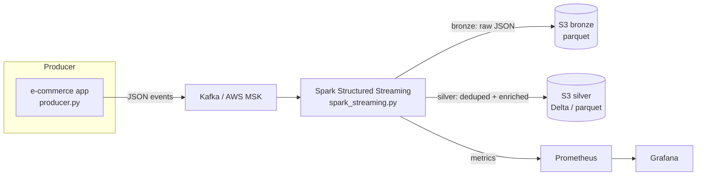

# Real-Time Kafka + AWS MSK + Spark Streaming Pipeline

An end-to-end real-time data pipeline for e-commerce clickstream events: Kafka producer → AWS MSK → Spark Structured Streaming → S3 / Delta Lake. Includes Terraform for the AWS bits and a small monitoring setup so you can see what's flowing.

I built this to show the full loop — local dev with Docker, then the same code against a real MSK cluster. Nothing fancy, just the pattern I reach for on most streaming jobs.

## Architecture



The producer simulates clickstream events (page views, add-to-cart, checkout). Spark reads them from Kafka, dedups by `event_id`, enriches with session info, and writes partitioned parquet to S3. Bronze keeps raw payloads; silver holds the cleaned table downstream jobs can trust.

## Tech stack

- **Streaming:** Apache Kafka (local), AWS MSK (prod), Spark Structured Streaming 3.5
- **Storage:** S3 + Delta Lake (or plain parquet if you skip Delta)
- **Infra:** Terraform (MSK cluster, S3 buckets, IAM), Docker Compose for local dev
- **Observability:** Prometheus + Grafana dashboard
- **Language:** Python 3.11 everywhere (PySpark for the streaming job)

## Project structure

```
.
├── src/
│   ├── config.py            # all settings in one place
│   ├── producer.py          # fake clickstream events -> Kafka
│   └── spark_streaming.py   # Structured Streaming job
├── terraform/
│   ├── main.tf              # MSK cluster, S3, IAM (placeholders)
│   └── variables.tf
├── monitoring/
│   ├── prometheus.yml
│   └── grafana-dashboard.json
├── docker-compose.yml       # local Kafka + Zookeeper
├── requirements.txt
└── .gitignore
```

## Prerequisites

- Python 3.11+
- Docker + Docker Compose (for local Kafka)
- Spark 3.5 with the Kafka + Delta packages (see `spark_streaming.py` header)
- AWS CLI configured (only needed for the MSK / S3 path)
- Terraform 1.6+ (only for the AWS infra)

## Run locally

1. Start a local Kafka:

```bash
docker compose up -d
```

2. Create the topic (auto-created by the producer too, but explicit is nice):

```bash
docker exec -it kafka kafka-topics.sh --create \
  --topic clickstream \
  --bootstrap-server localhost:9092 \
  --partitions 3 --replication-factor 1
```

3. Install deps and start the producer:

```bash
pip install -r requirements.txt
python src/producer.py
```

4. Run the streaming job in another terminal:

```bash
python src/spark_streaming.py --env local
```

It reads from `localhost:9092`, writes parquet to `./data/bronze` and `./data/silver`, and checkpoints to `./data/checkpoints`. Stop it with Ctrl+C — the checkpoint means you won't double-process on restart.

## Run on AWS (MSK + S3)

1. Fill in `terraform/variables.tf` with your VPC, subnets, and bucket names, then:

```bash
cd terraform
terraform init
terraform plan
terraform apply
```

This creates the MSK cluster, S3 buckets, and IAM roles. The Terraform here uses placeholder values on purpose — plug in your own account details.

2. Point the config at MSK:

```bash
export KAFKA_BOOTSTRAP_SERVERS="<your-msk-bootstrap-string>"
export S3_BRONZE_PATH="s3a://<your-bronze-bucket>/bronze"
export S3_SILVER_PATH="s3a://<your-silver-bucket>/silver"
python src/producer.py
python src/spark_streaming.py --env aws
```

For auth, I usually use IAM auth with MSK — set that up in your cluster's security config and make sure the Spark job's IAM role has `kafka-cluster:Connect` etc.

## Monitoring

Prometheus scrapes Spark's metrics sink (configured in `spark_streaming.py` via the metrics properties). Import `monitoring/grafana-dashboard.json` into Grafana to get throughput, consumer lag, and batch duration panels.

```bash
# prometheus + grafana are not in docker-compose here on purpose,
# run them however you normally do and point at monitoring/prometheus.yml
```

## Design notes

- **Idempotency:** dedup on `event_id` within a watermark window, so replays don't double-count.
- **Late data:** 10-minute watermark on `event_time`; adjust in `config.py` if your source is spikier.
- **Checkpoints:** always on S3 (or local disk for dev) — without them a restart replays everything.
- **Schema:** events are JSON with a small fixed schema; the streaming job validates and routes bad rows to a quarantine path instead of crashing.

## What I'd do next

- Add a dead-letter topic for malformed events instead of just a quarantine folder.
- Backfill job to reprocess bronze → silver when the enrichment logic changes.
- Exactly-once semantics with Kafka transactions if the business needs it.
